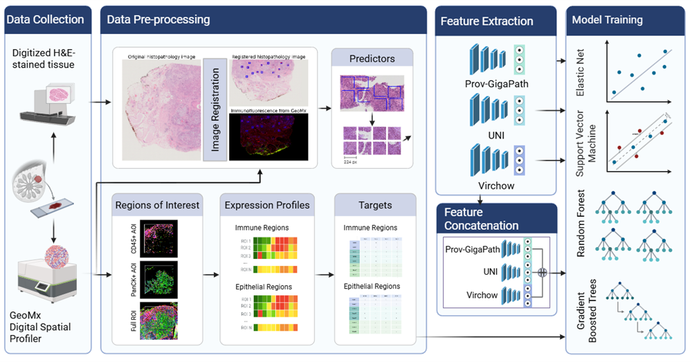

# Compartment-aware Spatial Gene Expression Prediction from Histology in Triple-Negative Breast Cancer

This project explores whether **spatial gene expression** can be inferred directly from **H&E-stained tissue images** using:

- **Pathology foundation models** (e.g., Virchow, UNI, Prov-GigaPath) for feature extraction
- **Traditional machine learning** algorithms (e.g., Support Vector Machines) for gene-wise prediction

---

## Pipeline

1. Extract H&E and IF regions at 10x using QuPath scripts
2. Register H&E to the IF using register_images.py (register_multiple.sh)
3. Extract patches of H&E correspoinding to ROI coordinates (02-extract_roi_patches.ipynb)
4. Extract ground truth gene expression  (03-extract_outcomes.ipynb)
5. Extract feature vectors using foundation models (04-feature_extractor.py)
6. Combine features from multiple FMs (05-combine_feature.ipynb)
7. **TRAIN  with cross validation** multiple modelsfor each geneset (07-predict_sge.py)
8. Merge CV results for each geneset (08-merge_cv_results.ipynb)
9. **Analyse results** and select best model combination (09-analyse_cv_results.ipynb)
10. Retrain with full training set and **evaluate on hold out test set** (10-evaluate_testset_performance.ipynb)
11. Pathway enrichment analysis (11-pathway_analysis.ipynb)
12. Evaluate Clinical Utility

